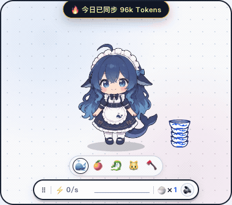

# 🐳 DeepSlack · 深度摸鱼（烧币版）

<p align="center">
  <strong>🇨🇳 中文</strong> &nbsp;|&nbsp; <a href="./README_EN.md"><strong>🇺🇸 English</strong></a>
</p>

**Turn your daily Claude Code / Codex / Antigravity token burn into a living anime desktop pet (macOS & Windows).**  
**一台靠烧真实 AI Token 喂养的赛博电子鸡——不烧算力就在桌面摸鱼，鼠标抓包就慌张喊「刚在深度思考」；终端一狂跑就红温冒烟！**

<p align="center">
  <a href="https://fanhhh1103.github.io/deepslack/"></a>
  <a href="https://github.com/fanhhh1103/deepslack/releases/latest"></a>
  <a href="https://x.com/evanpunk2077"></a>
  <a href="https://github.com/fanhhh1103/deepslack/stargazers"></a>
  <a href="./LICENSE"></a>
</p>

<p align="center">
  
</p>

<p align="center">
  🌐 <strong>手机党 / 懒得装客户端？点这里 3 秒网页直接开戳：</strong>
  <a href="https://fanhhh1103.github.io/deepslack/"><strong>https://fanhhh1103.github.io/deepslack/</strong></a>
</p>

---

## 🎀 全员 5 位 AI 娘全家福（一键切换 · 全员 39 帧丝滑全动作）

|  |  |  |  |  |
| :---: | :---: | :---: | :---: | :---: |
| **大肥鱼**<br/>DeepSeek | **大橘**<br/>Claude | **白龙**<br/>ChatGPT | **星猫**<br/>Gemini | **Grok娘**<br/>Grok |

---

## ⬇️ 一键直链下载（macOS & Windows）

无需装 Rust 或 Node，直接点击下方对应安装包下载即用（完整列表见 [Releases v1.1.0](https://github.com/fanhhh1103/deepslack/releases/tag/v1.1.0)）：

| 平台 / Platform | 一键直链下载 / Direct Download | 首次打开说明 / First Launch Tip |
| :--- | :--- | :--- |
| **macOS (Apple Silicon M1–M4)** | **[DeepSlack_1.1.0_aarch64.dmg](https://github.com/fanhhh1103/deepslack/releases/download/v1.1.0/DeepSlack_1.1.0_aarch64.dmg)** | 拖入 Applications 后若提示未签名/已损坏，终端执行一次：<br/>`xattr -cr /Applications/DeepSlack.app` *(unsigned build fix)* |
| **macOS (Intel)** | **[DeepSlack_1.1.0_x64.dmg](https://github.com/fanhhh1103/deepslack/releases/download/v1.1.0/DeepSlack_1.1.0_x64.dmg)** | 同上：`xattr -cr /Applications/DeepSlack.app` |
| **Windows 10 / 11 (x64 · 推荐)** | **[DeepSlack_1.1.0_x64-setup.exe](https://github.com/fanhhh1103/deepslack/releases/download/v1.1.0/DeepSlack_1.1.0_x64-setup.exe)** | 免管理员安装；若 SmartScreen 提示点 **「更多信息」→「仍要运行」** *(More info → Run anyway)* |
| **Windows 10 / 11 (x64 · MSI)** | **[DeepSlack_1.1.0_x64_en-US.msi](https://github.com/fanhhh1103/deepslack/releases/download/v1.1.0/DeepSlack_1.1.0_x64_en-US.msi)** | 标准 MSI 安装包 / Standard Windows MSI installer |

> 🗳️ **想接入 Cursor / Windsurf / OpenClaw / Kiro 等下一家 AI 工具？** 欢迎去置顶投票 Issue 投一票（顺手点个 Star ⭐）：**[Issue #1 投票入口](https://github.com/fanhhh1103/deepslack/issues/1)**

---

## ✨ 核心亮点

1. **实时算力转速表 × 摸鱼抓包反差萌**：
   - 本地实时监测 **Claude Code** (`~/.claude`)、**Codex** (`~/.codex`)、**Antigravity** (`~/.gemini/antigravity-cli`) 的 Token 消耗速率（`freshTokensPerSec` 12s 窗口 + EMA 平滑）。
   - 自动切换 **摸鱼 / 慢炖 / 全力 / 红温冒烟** 4 档姿态：闲着时抱鱼干看漫画，鼠标移入立刻抓包弹起“*咳！我没摸鱼，刚在深度思考！*”；狂烧 Token 时 4 帧机械键盘猛敲到红温冒烟、跑完累瘫。
2. **多帧丝滑动画 × 桌面自由交互**：
   - 二阶弹簧动力学 + 体积守恒果冻形变 + 等功率跨帧混切，支持 4 帧走路溜达、边缘探头、拎起狂摇眩晕、丢玩具/投喂叠青花饭碗塔、3 段式重锤拍飞小 Bug 与鲸鱼耳机摇摆听歌。
   - 原生 **Tauri v2** 全透明无边框置顶窗口，系统托盘一键置顶、自由溜达、刷新快照与重置位置。
3. **100% 本地只读 · 隐私绝对安全**：
   - 仅在本地只读统计当日新增 Token 数量，**绝不读取任何对话正文、提示词、代码或 API 密钥，也不联网上传任何数据**。
4. **内置可切换轻肉鸽小游戏引擎**：
   - 仓库内保留了《幸运房东》风格的九宫格算力老虎机引擎（`src/game/`），当前通过 [`src/config.ts`](./src/config.ts) 中的 `ENABLE_SLOT_MACHINE = false` 默认保持纯享桌宠模式，方便后续或二开自行开启。

---

## 🧑‍💻 开发者本地运行与构建

```bash
# 1. 安装依赖并启动浏览器试玩版
npm install
npm run dev

# 2. 类型检查、单测与前端构建
npm run typecheck
npm test
npm run build

# 3. 运行 Rust 扫描器单测并打包原生桌面应用
(cd src-tauri && cargo test)
npx @tauri-apps/cli@2 build

# macOS 也可以直接双击或运行根目录 ./启动桌宠.command (macOS one-click launcher)
```

---

## 📜 开源协议与署名

MIT License · Created by **[@evanpunk2077](https://x.com/evanpunk2077)**（角色设定源自漫画X企划）
