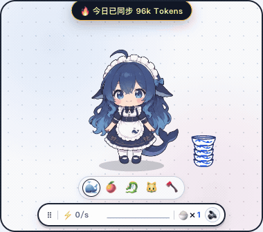

# 🐳 DeepSlack — AI Token Desktop Pet

<p align="center">
  <a href="./README.md"><strong>🇨🇳 中文</strong></a> &nbsp;|&nbsp; <strong>🇺🇸 English</strong>
</p>

**Turn your daily Claude Code / Codex / Antigravity token burn into a living anime desktop pet (macOS & Windows).**  
When your terminal is idle, she slacks off eating dried fish — hover over her and she panics *"I wasn't slacking, I was deep-thinking!"*. Crank up your agents and she smashes her RGB mechanical keyboard until she overheats!

<p align="center">
  <a href="https://fanhhh1103.github.io/deepslack/"></a>
  <a href="https://github.com/fanhhh1103/deepslack/releases/latest"></a>
  <a href="https://x.com/evanpunk2077"></a>
  <a href="https://github.com/fanhhh1103/deepslack/stargazers"></a>
  <a href="./LICENSE"></a>
</p>

<p align="center">
  
</p>

<p align="center">
  🌐 <strong>On mobile or want a 3-second preview without installing?</strong>
  <a href="https://fanhhh1103.github.io/deepslack/"><strong>Play the Live Web Demo →</strong></a>
</p>

---

## 🎀 Meet the 5 Switchable AI Girl Pets

|  |  |  |  |  |
| :---: | :---: | :---: | :---: | :---: |
| **Dafeiyu (大肥鱼)**<br/>DeepSeek | **Daju (大橘)**<br/>Claude | **Bailong (白龙)**<br/>ChatGPT | **Xingmao (星猫)**<br/>Gemini | **Grok-chan**<br/>Grok |

---

## ⬇️ Direct Downloads (macOS & Windows)

Prebuilt installers — no Rust or Node required (full release page: [v1.0.0](https://github.com/fanhhh1103/deepslack/releases/tag/v1.0.0)):

| Platform | Direct Download | First Launch Note (Unsigned Open-Source Build) |
| :--- | :--- | :--- |
| **macOS (Apple Silicon M1–M4)** | **[DeepSlack_1.0.0_aarch64.dmg](https://github.com/fanhhh1103/deepslack/releases/download/v1.0.0/DeepSlack_1.0.0_aarch64.dmg)** | Drag `DeepSlack.app` to Applications. If Gatekeeper flags it as damaged/unidentified, run once:<br/>`xattr -cr /Applications/DeepSlack.app` |
| **macOS (Intel)** | **[DeepSlack_1.0.0_x64.dmg](https://github.com/fanhhh1103/deepslack/releases/download/v1.0.0/DeepSlack_1.0.0_x64.dmg)** | Same as above: `xattr -cr /Applications/DeepSlack.app` |
| **Windows 10 / 11 (x64 · Recommended)** | **[DeepSlack_1.0.0_x64-setup.exe](https://github.com/fanhhh1103/deepslack/releases/download/v1.0.0/DeepSlack_1.0.0_x64-setup.exe)** | Per-user installer (no admin prompt). On Windows SmartScreen, click **"More info" → "Run anyway"**. |
| **Windows 10 / 11 (x64 · MSI)** | **[DeepSlack_1.0.0_x64_en-US.msi](https://github.com/fanhhh1103/deepslack/releases/download/v1.0.0/DeepSlack_1.0.0_x64_en-US.msi)** | Standard Windows MSI installer. |

> 🗳️ **Want Cursor, Windsurf, OpenClaw, or Kiro support next?** Vote in our pinned poll (and drop a ⭐): **[Issue #1 Poll](https://github.com/fanhhh1103/deepslack/issues/1)**

---

## ✨ Highlights

1. **Live Token Tachometer × Slacking-Caught Reactions**:
   - Reads local daily token usage from **Claude Code** (`~/.claude`), **Codex** (`~/.codex`), and **Antigravity** (`~/.gemini/antigravity-cli`) using an incremental 12s fresh-token rate window + EMA smoothing.
   - Automatically shifts across 4 live energy tiers (**Idle/Slacking → Simmer → Full Power → Overheat**), plus rice bowl towers dropped per 4M burned tokens and exhausted collapse when a heavy run finishes.
2. **Silky Multi-Frame Physics & Playful Desktop Interactions**:
   - Custom second-order spring physics, volume-preserving squash & stretch, equal-power crossfades, 4-frame walk/work/music/eat cycles, edge peeking, shake-to-dizzy drag pendulum, 3-stage hammer bug bonk with hitstop & shockwave, and original Web Audio procedural SFX.
   - Transparent, frameless, always-on-top **Tauri v2** window with system tray toggles (Always on Top, Free Walk, Refresh Tokens, Reset Position).
3. **100% Local & Read-Only Privacy**:
   - Counts numeric token deltas locally only — **never reads prompts, code, or API keys, and makes zero network requests**.
4. **Built-In Roguelike Mini-Game Module**:
   - Includes a *Luck be a Landlord*-inspired 3×3 token slot engine in `src/game/` (disabled by default via `ENABLE_SLOT_MACHINE = false` in [`src/config.ts`](./src/config.ts) for a clean desktop pet experience).

---

## 🧑‍💻 Build From Source

```bash
# 1. Install dependencies & run the browser demo
npm install
npm run dev

# 2. Typecheck, test, and build frontend
npm run typecheck
npm test
npm run build

# 3. Run Rust scanner tests & build native desktop installers
(cd src-tauri && cargo test)
npx @tauri-apps/cli@2 build

# macOS users can also run ./启动桌宠.command (macOS one-click launcher)
```

---

## 📜 License & Credits

MIT License · Created by **[@evanpunk2077](https://x.com/evanpunk2077)** (character art originated from the MangaX project).
